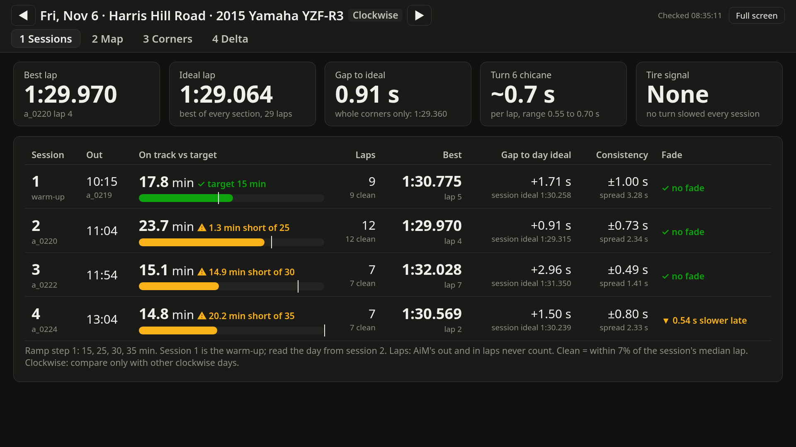
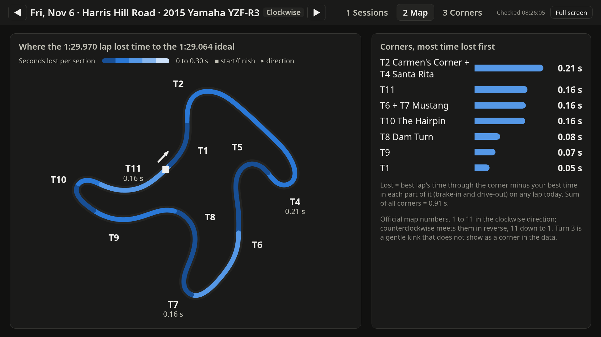
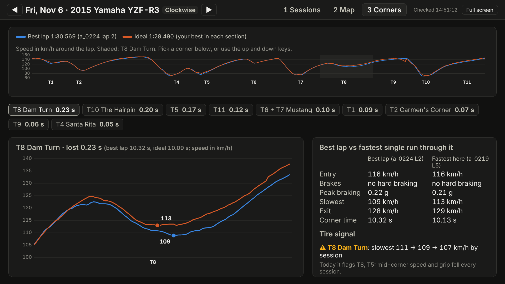
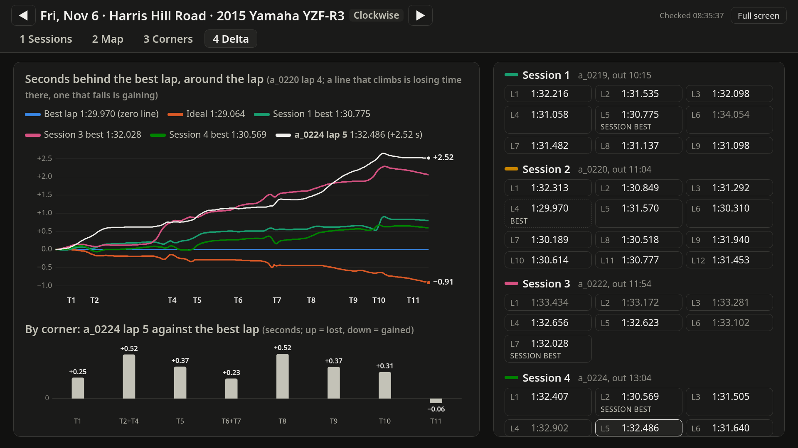
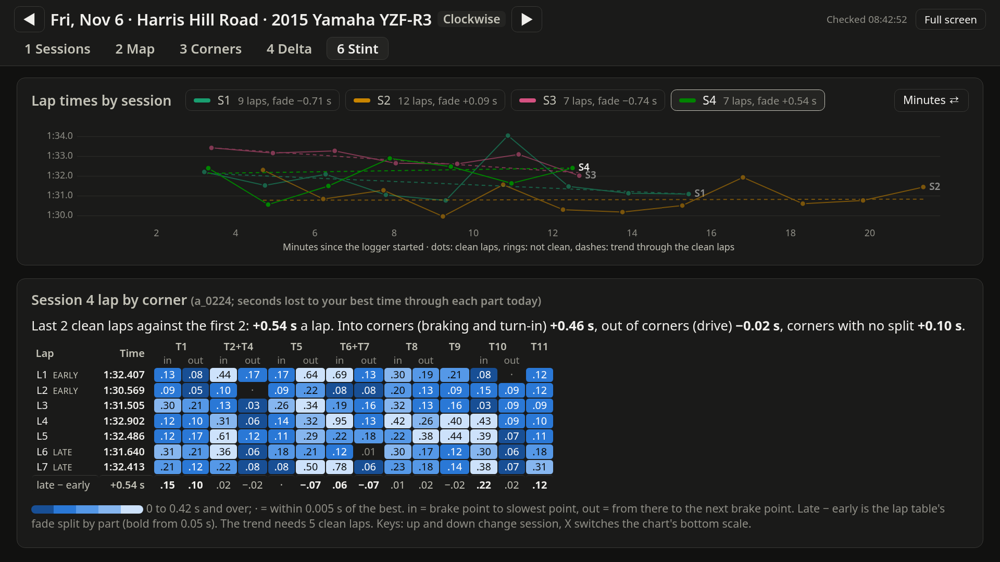

# Pit lap viewer

A small local web app for the pits: it reads AiM Solo DL `.xrk` files from any track, runs the
analysis in `../scripts/`, and shows each day full screen on a laptop or an HDMI TV. It runs
offline once installed, and only listens on `127.0.0.1` (nothing leaves the laptop).

## Install and start

**Windows:** install 64-bit Python 3.10 to 3.14 from python.org (once), then double-click
`start_windows.bat`. The first start creates `.venv` and installs the packages in
`../requirements.txt` (needs internet, a few minutes). Every package has a ready-made Windows
wheel, so no compiler is needed. After that it starts in seconds with no internet and opens
<http://127.0.0.1:8765> in your browser. Close the black window to stop it.

**Linux (Fedora):** `bash start_linux.sh` (or `./start_linux.sh` once it is executable) does the same with `python3`.

**By hand:** `python3 -m pip install -r ../requirements.txt`, then `python3 -I lapviewer.py`.

Options: `--folder PATH` (watch another folder), `--port N`, `--no-browser`, `--once`
(analyse the folder, write summaries, exit).

## Where files go

| Folder | What | Setting in `config.json` |
|---|---|---|
| `xrk/` | Where it looks for `.xrk` / `.xrz` files, including subfolders. Files dropped on the page are saved in `xrk/dropped/`. Point it at the folder Race Studio 3 saves to and new sessions show up on their own. Where a `.xrz` sits next to the `.xrk` of the same session, only the `.xrk` is read. | `xrk_folder` |
| `summaries/<date>/` | Small results per day: `day.json` (everything the viewer shows), `sessions.csv`, `laps.csv`, one `<session>.json` per session. About 150 KB a day. Point this at a synced cloud folder (for example Google Drive for desktop) to get results there without uploading the large `.xrk` files. | `summary_folder` |
| `data/` | Analysis cache (the same outputs `run_day.py` writes, plus logs). Safe to delete; it is rebuilt. | `data_folder` |

`config.json` is created on first start. Relative paths are inside `viewer/`; absolute paths
like `D:\\AiM\\data` or `G:\\My Drive\\Track lap data\\summaries` work too (write each backslash twice in JSON).
Other settings: `ramp_targets_min` (target minutes per session, session 1 first), `ramp_label`,
`speed_unit` (`"kmh"` or `"mph"`), `port`, `scan_seconds`, `open_browser`.

A new or changed day is analysed in about 15 to 40 seconds; the status at the top right says
what it is doing. Files still being copied are skipped until they stop changing. Every day is
analysed again after the scripts or a track definition (`../tracks/`) change, for example after an
update or after you edit a track's turn table.

## The views

Keys: the number on each tab switches to that view, left and right arrows change day, `F` toggles
full screen, up and down arrows pick a corner on view 3, a lap on view 4 and a session on view 6.
Text sizes follow the screen width, so the same page reads on a laptop and a TV. The top bar names the day, the track, the bike and the
direction, with the view tabs on the row below.

1. **Sessions:** best lap, ideal lap (best time in every section), gap, the cost of a cone chicane
   where the track defines one (Harris Hill's turn 6, clockwise), tire signal; then each session's
   time on track against the ramp target, laps, best, gap to the day's ideal, consistency and
   fade. Session 1 is the warm-up.
2. **Map:** the track coloured by time lost per section on the best lap, with the turn numbers and
   the three biggest losses labelled, plus a ranked list of corners. Turn numbers are the official
   ones where the track has a turn table in `../tracks/`; at any other track they are in riding
   order from the start/finish line, and the view says so (see "Tracks" in the main README).
3. **Corners:** speed around the lap (best lap against the ideal), then one corner zoomed in with
   brake points and slowest speeds, best lap against the fastest single run through it, and the
   tire signal (slowest mid-corner speed by session) for that corner's turns.

4. **Delta:** seconds behind the best lap at every point of the track. The best lap is the zero
   line; a line that climbs is losing time there and one that falls is gaining. It draws the ideal
   lap (it falls where the best lap left time) and each session's best lap, and any other lap you
   pick from the list on the right (click it, or step with the up and down keys; pick it again to
   clear it). Under the chart, bars show what the picked lap lost or gained in each corner, or
   what the ideal gains when no lap is picked. Every lap in the day's direction that the GPS
   recorded fully can be picked, including laps too slow to count toward the ideal (greyed).

6. **Stint:** for endurance work. On top, every session's lap times against minutes on track
   (`X` switches to lap number), one line per session. Dots are clean laps and rings are laps that
   are not clean; the dashed line is the trend through the clean laps, drawn from five clean laps
   up, and it is a line that one lap in traffic cannot tilt. Below, the picked session lap by
   corner: what each lap lost to your best time today through each part of each corner, coloured
   by size. "in" is from the brake point to the slowest point, "out" from there to the next brake
   point. The bottom row is late minus early: the last third of the session's clean laps against
   the first third in every part, which is the session board's fade split up, with one sentence
   that totals it into corners and out of corners. Time that goes missing late into corners points
   at braking and turn-in; time that goes missing on the way out points at drive and grip. A lap
   the GPS did not fully record shows its reason instead of numbers.

Rules carried over from the tools: lap times are compared only within one track and one direction
(both from GPS); AiM's own out and in laps never count; laps more than 3% off the day's best, and
laps the GPS did not fully record, are left out of the ideal; throttle and braking are inferred
from GPS speed (there is no throttle or brake channel).

## How it fits together

`lapviewer.py` (standard library only) watches the folder, groups files by the date the logger
recorded, and runs `../scripts/run_day.py` for each new or changed date into `data/analysis/`.
`xrk_ideal_lap.py` writes `viewer.json` (track path, sections, speed traces, each lap's time
delta along the track, and each session's trend and late-against-early numbers) next to its PNGs; the server combines it with the CSVs the other scripts
write and serves it to `static/` (plain HTML, CSS and SVG, no libraries or internet).
